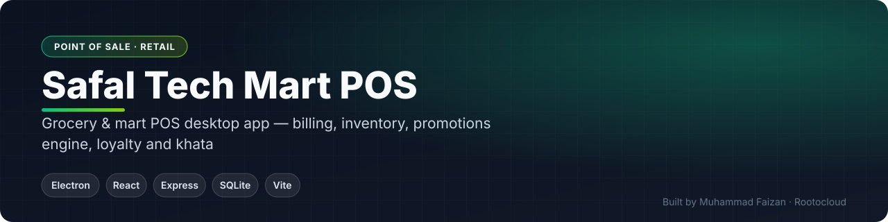
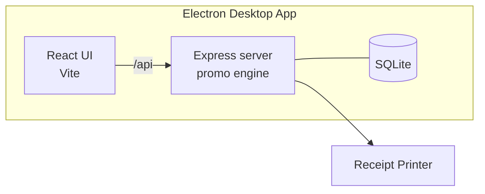
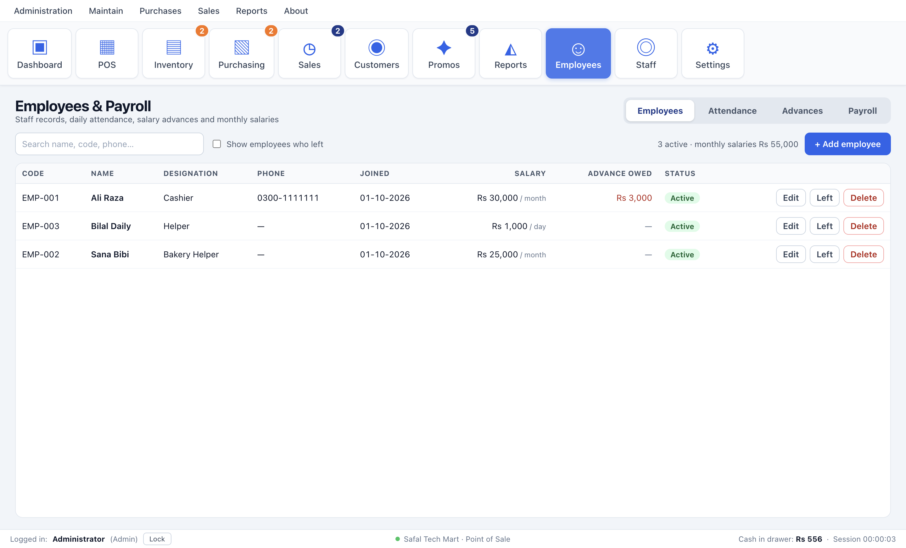
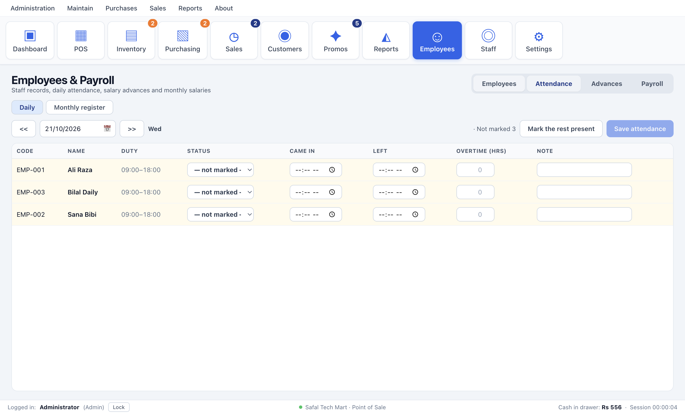
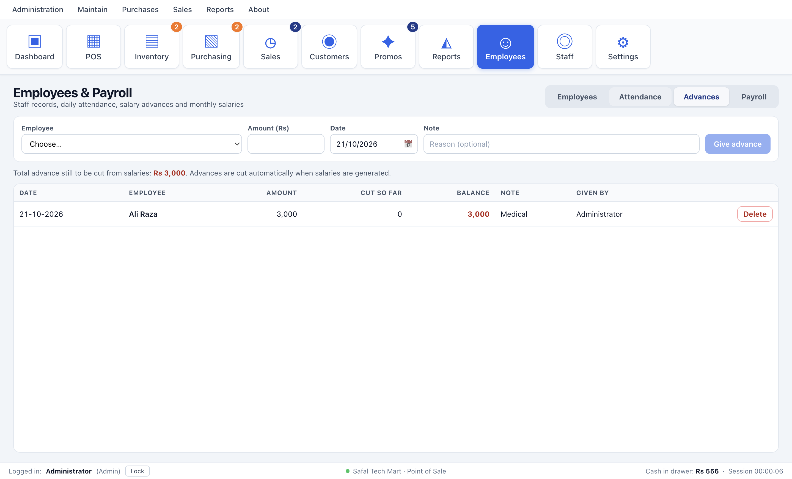
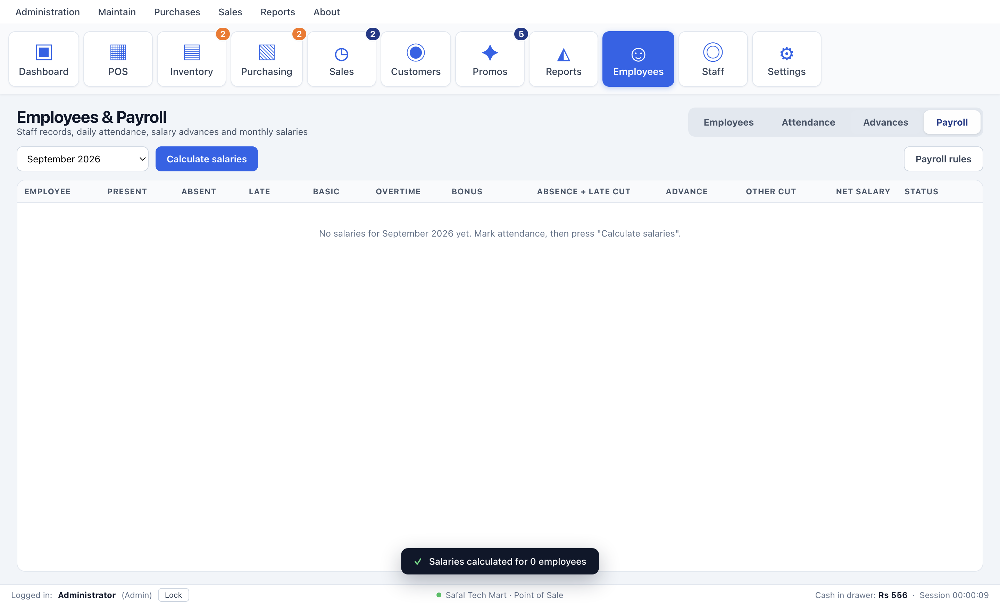

 

    

 

**[Request a live demo](https://rootocloud.com) · [Hire me](mailto:faizan.developer9200@gmail.com) · [More projects](https://github.com/MuhammadFaizan73)**

---

## 📌 Overview

A retail and grocery point-of-sale built as a desktop app that also runs in the browser for development. All totals are computed on the server at checkout, with a promotions engine supporting buy-x-get-y, quantity discounts, combos and cart-value rules.

## ✨ Key Features

### Billing
- Barcode scan and search, categories, multi-bill tabs
- Hold and recall that survives a restart
- Split payments, returns and refunds, printed receipts

### Customers
- Loyalty points with tiers and redemption
- Khata (customer credit) balances updated automatically

### Inventory & Promotions
- Stock adjustments with audit trail and reorder levels
- Promotions engine: buy-x-get-y, quantity %, combo, cart-value
- Sales history with gross, returns, net and average basket stats

### HR
- Employees and payroll module

## 🏗️ Architecture

## 🧰 Tech Stack

| Layer | Technology |
|---|---|
| **Desktop** | Electron · electron-updater |
| **Frontend** | React · Vite · React Router · Zustand |
| **Backend** | Express (embedded) |
| **Database** | SQLite (better-sqlite3) |
| **Builds** | Windows .exe · macOS .dmg · Linux AppImage |

<!-- SCREENSHOTS -->
## 📸 Screenshots

  
  
  
  

<!-- /SCREENSHOTS -->

## 🔒 About the Source Code

This is a **commercial / client project**, so the source code is kept in a private repository.
This page documents what the system does and how it is built.

- 🎥 **Live walkthrough** — available on request
- 💼 **Want something similar for your business?** I build custom versions of this for clients.

## 👨‍💻 Author

**Muhammad Faizan** — Founder, [Rootocloud](https://rootocloud.com)
AI agents & automation · Web & mobile apps · Custom software

© Muhammad Faizan. All rights reserved.

